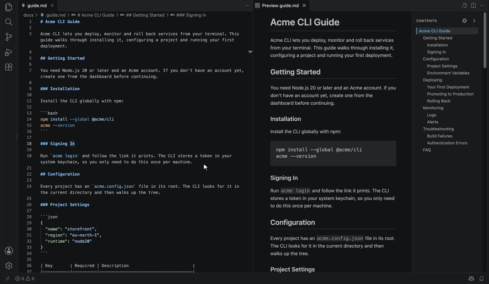
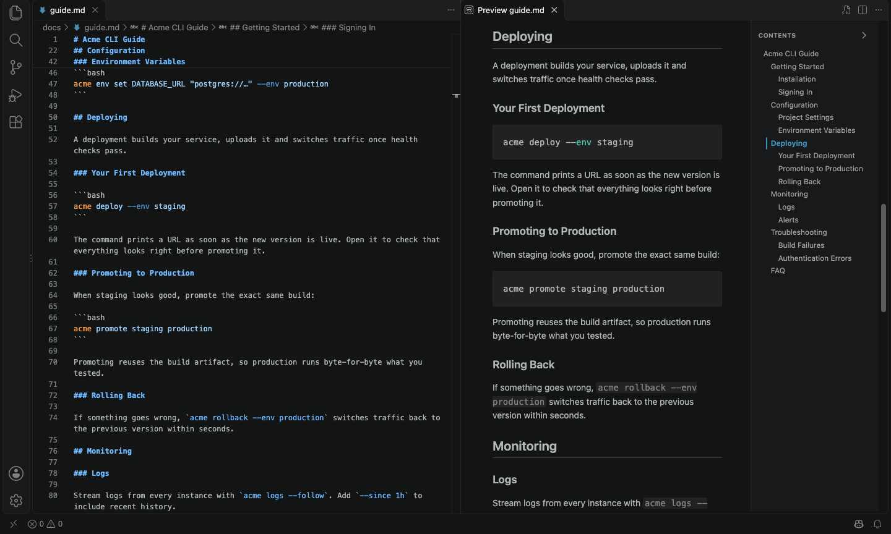
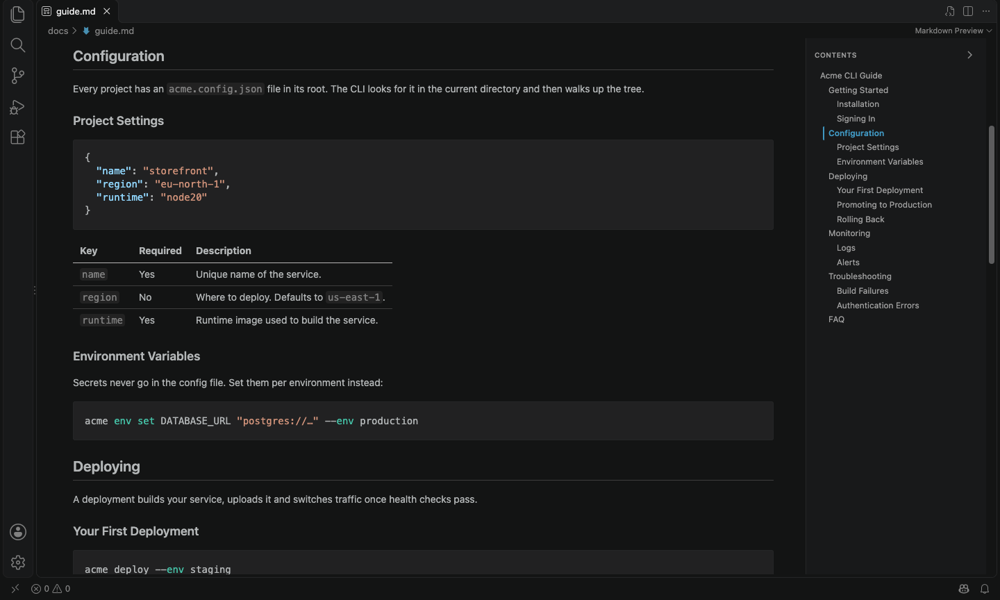
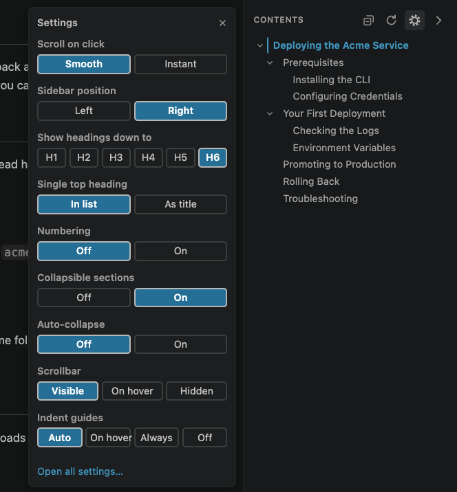
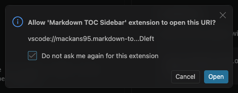

# Markdown TOC Sidebar

Adds a table of contents sidebar to VS Code's built-in Markdown preview, built from the headings in your document. It only reads the rendered preview and never changes your Markdown files.

## Features

- **Table of contents for every preview.** Headings `h1`–`h6` are listed and nested by level. It works as soon as it's installed, with no command to run.
- **Live updates.** Add, rename or remove a heading and the sidebar updates as you type.
- **Click to jump.** Clicking an entry smoothly scrolls the preview to that heading, leaving a little space above it, and the heading flashes briefly so you can see where you landed. Prefer an instant jump? See [Settings](#settings).
- **Current section highlight.** The entry for the section you're reading is highlighted as you scroll, and the list keeps it in view. The sections it belongs to are highlighted more lightly, so you can see where you are in the structure.
- **Hide and show.** The arrow button in the sidebar's header hides it when you want the full width, and brings it back.
- **Left or right.** Put the sidebar on whichever side of the preview you prefer.
- **Settings at hand.** The cog button in the sidebar's header opens a small menu for the extension's settings, so you don't have to go to VS Code's Settings. VS Code asks for permission the first time; see [Changing settings from the sidebar](#changing-settings-from-the-sidebar).
- **Refresh button.** The circular arrow in the sidebar's header re-renders the preview from the file, the same as VS Code's *Markdown: Refresh Preview*. Useful when something the preview doesn't watch has changed, like a stylesheet. Like the settings menu, VS Code asks for permission the first time.
- **Resizable.** Drag the sidebar's inner edge to change its width, or double-click the edge to reset it. With the edge focused, the arrow keys work too.
- **Remembered.** The width and the hidden/shown choice carry over to other previews, including after restarting VS Code. VS Code keeps side-by-side previews and the Markdown Preview editor separate, so each of those remembers its own.
- **Smoother scroll sync.** When you scroll the editor, the preview glides to its new position instead of jumping.
- **Matches your theme.** The sidebar uses your color theme's colors.

## Usage

Install the extension and open any Markdown file as a preview. The sidebar appears automatically in:

- **Markdown: Open Preview to the Side** (`Ctrl+K V`, or `Cmd+K V` on macOS)
- **Markdown: Open Preview** (`Ctrl+Shift+V`, or `Cmd+Shift+V` on macOS)
- The **Markdown Preview** editor (*Open as Preview* in the editor toolbar)

If the preview is very narrow (under 360px), the sidebar hides itself so the document keeps enough room.

## Settings

| Setting | Default | Description |
|---|---|---|
| `markdownTocSidebar.scrollBehavior` | `smooth` | How the preview scrolls when you click an entry: `smooth` animates the scroll, `instant` jumps straight there. When your system is set to reduce motion, it always jumps instantly. |
| `markdownTocSidebar.position` | `right` | Which side of the preview the sidebar is shown on: `left` or `right`. |

You can change these from the cog menu in the sidebar, or in VS Code's Settings (search for "Markdown TOC Sidebar"). Either way, open previews update right away.

### Changing settings from the sidebar

Click the **cog** in the sidebar's header to open the settings menu. A choice takes effect immediately, and the menu stays open until you close it with its **×** button, click outside it, or press `Escape`.

> **Heads-up: the first time you change a setting from this menu, VS Code asks for permission.** This happens only once:
>
> 1. Pick an option in the menu, for example **Left**.
> 2. VS Code asks: *"Allow 'Markdown TOC Sidebar' extension to open this URI?"*
> 3. Tick **Do not ask me again for this extension**.
> 4. Click **Open**.
>
> 
>
> The setting is saved. From then on, changes from the menu are saved without the question.

Other open previews of the same kind (side-by-side, or the Markdown Preview editor) follow along immediately. An open preview of the other kind picks the change up the next time it updates, for example when you edit the file.

**Why VS Code asks:** the preview can't change VS Code settings by itself. Each option in the menu is a `vscode://` link to this extension, and VS Code checks with you before an extension handles such a link. The extension only uses these links to update its own two settings, to open the Settings editor (*Open all settings…*) and to refresh the preview (the refresh button). Allowing them once covers all of these.

If you click **Cancel**, the setting isn't saved. The preview keeps showing your choice for now, but goes back to the saved setting the next time it reloads. If you'd rather not allow the links at all, change the settings in VS Code's Settings instead.

Changing a setting in VS Code's Settings reloads open previews to apply it, and they then scroll to match where the editor is.

## Tips

These are VS Code settings, not settings of this extension:

- **Double-click a heading to jump to it in the source.** Turn on `markdown.preview.doubleClickToSwitchToEditor`. Double-clicks inside the sidebar never jump to the editor.
- **Smoother scrolling in the other direction.** This extension smooths the preview when you scroll the editor. To also smooth the editor when you scroll the preview, turn on `editor.smoothScrolling`. Note that this also animates normal mouse-wheel scrolling in the editor.

## Requirements

VS Code 1.82 or later. The extension only adds to the built-in Markdown preview, so it doesn't work with other preview extensions such as Markdown Preview Enhanced.

## Known limitations

- Only Markdown headings (`#`, `##`, …) are listed. Headings written as raw HTML, like `<h2>`, are not.
- The sidebar width and the hidden/shown state are saved per kind of preview (side-by-side, or the Markdown Preview editor), not per file.

## Privacy

The extension has no telemetry and makes no network requests.

## How it works

The extension uses VS Code's Markdown preview extension points (`markdown.previewScripts`, `markdown.previewStyles` and `markdown.markdownItPlugins`).

- `media/toc.js` builds the sidebar from the rendered headings, which already have `id`s, and rebuilds it whenever the preview content changes.
- `media/smooth-scroll-sync.js` takes over the preview's scroll-sync jumps and animates them instead.
- `media/toc.css` styles the sidebar using your theme's colors.
- `src/extension.js` connects the preview to VS Code settings, which the preview can't access itself. It adds a hidden element carrying the settings to each rendered preview, and refreshes open previews when a setting changes. The cog menu's options are `vscode://` links, which VS Code hands to this file's URI handler to update the setting. The refresh button is such a link too, and runs VS Code's *Markdown: Refresh Preview*.

## Development

1. Clone the repository and open it in VS Code.
2. Press `F5` to open a test window with the extension loaded and `sample.md` open.
3. Open the preview with `Cmd+K V` / `Ctrl+K V`.

There are two launch configurations. **Run Extension (no other extensions)** disables your installed extensions in the test window, so the Debug Console only shows output from this extension and VS Code's built-ins.

The extension has no build step. After editing a file in `media/`, run **Developer: Reload Window** in the test window to load the change.

## License

[MIT](LICENSE)
